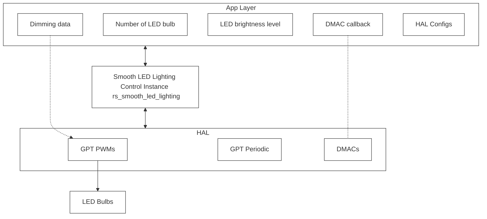
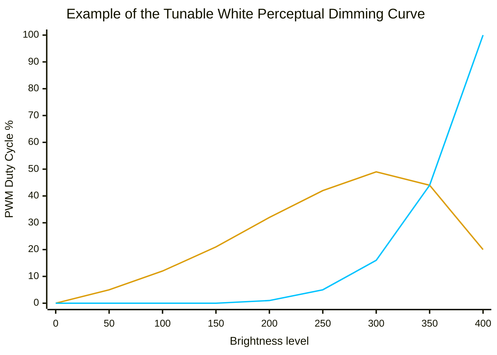
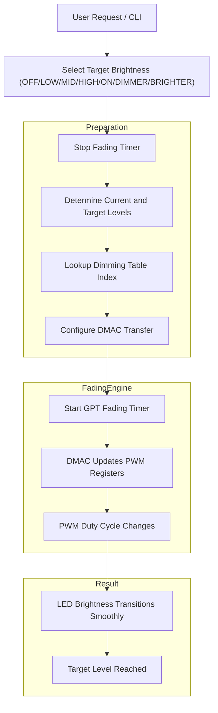

# Smooth Lighting Control

## Table of Contents
* [1. Introduction](#1-introduction)
* [2. Hardware and Tool Support](#2-hardware-and-tool-support)
* [3. MCU Resource Use](#3-mcu-resource-use)
* [4. System Block Diagram](#4-system-block-diagram) 
* [5. Smooth LED Lighting Transition Flows](#5-smooth-led-lighting-transition-flows)
* [6. Basic LED Dimming Sequence](#6-basic-led-dimming-sequence)
* [7. Module Layer Code and Demonstration Code](#7-module-layer-code-and-demonstration-code)
* [8. Configuration Assumptions for the Reference Board](#8-configuration-assumptions-for-the-reference-board)
* [9. Public Functions — Where to Start](#9-public-functions--where-to-start)
* [10. Reference Application](#10-reference-application)
* [11. Adapting to Your Board](#11-adapting-to-your-board)
* [12. Running the Project and Expected Output](#12-running-the-project-and-expected-output)

## 1. Introduction

The Smooth LED Brightness Controller provides smooth, flicker-free brightness transitions for multiple LED bulbs using GPT PWM outputs, a GPT periodic timer, DMAC, and ELC. The design minimizes CPU utilization by offloading PWM output updates and timing operations to dedicated hardware peripherals.

The example application demonstrates smooth transitions between predefined brightness levels in response to user commands entered through the CLI. Each brightness change is performed using a controlled fade operation rather than an instantaneous step change, resulting in visually smooth LED intensity transitions.

### Supported Brightness Control Commands

| Command | Description |
|---|---|
| OFF | LED off (0% brightness) |
| LOW | Transition to low brightness level|
| MID | Transition to medium brightness level |
| HIGH | Transition to high brightness level |
| FULL_ON | Transition to maximum brightness level|
| ON | Transition to the brightness level before OFF|
| DIMMER| Decreases the brightness by one predefined level|
| BRIGHTER| Increases the LED brightness intensity one predefined level |

- BRIGHTER command increases the LED brightness intensity one predefined level at a time until the maximum level (FULL_ON) is reached.
- DIMMER command decreases the LED brightness intensity one predefined level at a time until the minimum selectable level (LOW) is reached.

In addition to brightness intensity control, the application supports dynamic color temperature adjustment, emulating the behavior of incandescent and modern tunable-white lighting. As the light output is dimmed, the LED color becomes warmer. As the brightness increases, the LED color gradually shifts toward a cooler white. Both brightness and color temperature transitions are smoothly ramped to eliminate abrupt visual changes.

### Key Features

- Smooth fade-in and fade-out transitions between brightness levels.
- Hardware-accelerated PWM updates using DMAC.
- ELC event chaining to minimize CPU intervention.
- Multi-channel LED brightness control.
- CLI-based control interface for testing and demonstration.
- Scalable architecture suitable for lighting and embedded control applications.

### Project Structure

```
.
├── README.md
│   └── Documentation for the RS Smooth LED Lighting controller   
│        
├── Examples
│   └── VSCode
│       │   
│       │── Smooth_LED_LightingFPB_RA4E2
│       │    └── The demo project demonstrates smooth LED lighting control, including brightness and transition effects
│       │
│       └── executable
│            └── Excecutable of the demo project
├── src
│   │── config   
│   │    └── Module configuration generation and checking functions
│   │       
│   │   
│   │── smooth_led_lighting.c
│   │        └── Smooth LED Light Control module main source code
│   │   
│   └── smooth_led_lighting.h
│           └── Smooth LED Light Control module header file
│   
```
## 2. Hardware and Tool Support

| Hardware Item | Description |
|---|---|
| Reference Board | FPB-RA4E2 |
| Device Family | RA4E2 |
| External Hardware | Light Bulb Demo PMOD |

| IDE Tool/RTOS/FSP| Description |
|---|---|
| IDE / TooL| VS Code/Renesas extensions for VS Code |
| FSP| v6.5.0 |
| RTOS | Not required |

## 3. MCU Resource Use

| Item | Description |
|---|---|
| PWM Driver | R_GPT |
| Fade Timing Driver | R_GPT |
| DMA Driver | R_DMAC |
| Event Routing | R_ELC |
| Board I/O | R_IOPORT |

## 4. System Block Diagram
This diagram shows how the Smooth LED Lighting Control module coordinates application settings, dimming data, hardware timers, DMA controllers, and PWM outputs to generate smooth LED brightness transitions and warm/cool color mixing.


## 4.1. Smooth LED Lighting Control Instance Configuration

The application defines the number of LED bulbs managed by each Smooth LED Lighting Control instance. Each instance independently controls one or more LED bulbs and requires a dedicated set of hardware resources.

The minimum hardware resources required for a single Smooth LED Lighting Control instance are:

- One GPT timer configured as a fading control/periodic timer
- One GPT timer configured for PWM generation
- Two DMAC channels for automatic PWM duty-cycle updates

Multiple Smooth LED Lighting Control instances can coexist within a single system, allowing independent control of multiple groups of LED bulbs. The maximum number of instances supported depends on the available GPT and DMAC resources of the target MCU.

### 4.1.1. Sharing Resources Across Multiple LED Bulbs
- A Smooth LED Lighting Control Instance can control multiple LED bulbs by sharing a single fading-control timer while using multiple PWM timers.
- For example:
```text
     Smooth LED Lighting Control Instance
     │
     ├── GPT Fading Timer
     │
     ├── PWM Timer 0
     │   │
     │   ├── GTIOCA → Warm LED Bulb 0
     │   └── GTIOCB → Cool LED Bulb 0
     │
     ├── PWM Timer 1
     │   │
     │   ├── GTIOCA → Warm LED Bulb 1
     │   └── GTIOCB → Cool LED Bulb 1
     │
     └── PWM Timer 2
           ├── GTIOCA → Warm LED Bulb 2
           └── GTIOCB → Cool LED Bulb 2
```
In this configuration, all bulbs follow the same dimming cadence generated by the shared fading timer.

### 4.1.2. Multiple Dimming Control Instances
A system may contain multiple Smooth LED Lighting Control instances.
- Each instance can:
  - Control a different group of LED bulbs.
  - Use a different dimming table to implement different warm/cool LED mixing profiles.
  - Use different fade rates or timing parameters.
  - Operate independently of other lighting groups.
- For example:
```text
      Smooth LED Lighting Control Instance 0
      ├── Living Room LEDs
      ├── Slow Fade Profile
      └── Warm-to-Cool Mixing
     
      Smooth LED Lighting Control Instance 1
      ├── Kitchen LEDs
      ├── Fast Fade Profile
      └── Cool-White Bias
     
      Smooth LED Lighting Control Instance 2
      ├── Accent Lighting
      ├── Custom Dimming Curve
      └── Warm-White Output
```
This architecture provides a scalable and flexible framework for controlling multiple LED bulbs and lighting zones while maintaining smooth brightness transitions.

## 4.2. Brightness and Dimming Data Setup

The application provides:

- A dimming data table containing the PWM duty-cycle values used during brightness transitions.
- A set of predefined brightness levels (such as OFF, LOW, MID, HIGH, and FULL_ON).

## 4.3. Automatic Brightness Fading

- The fading control timer generates periodic events during a brightness transition.
- These events trigger DMAC transfers that automatically move dimming values from the dimming table to the PWM timer register.
- As the PWM duty cycle changes, the LED brightness smoothly ramps up or down without requiring CPU intervention.

## 4.4. Transition Completion

- When all dimming values have been transferred, a DMAC transfer-end event occurs.
- The transfer-end event invokes an application callback function.

## 4.5. State Update

A DMAC callback updates the current LED dimming state.

## 4.6. Smooth LED Lighting Data Transitions Diagram

The PWM timer overflow event is configured as the count-up source for the fading control timer. Each PWM period increments the fading timer counter by one. When the fading timer reaches its configured period and overflows, it generates a trigger that activates the DMAC. The DMAC transfers the next warm and cool PWM duty-cycle values from the dimming table to the PWM timer registers, producing a smooth hardware-controlled brightness transition.

```text
                Off              Low                Medium                 High              Full-On
                |__________________|___________________|_____________________|__________________|
    Brightness  |                  |                   |                     |                  | Warm
    level       |__________________|___________________|_____________________|__________________|
    data        |                  |                   |                     |                  | Cool
                |__________________|___________________|_____________________|__________________|
                0 1 2 ...          |                                         |             ... n-1
                                   |                                         |          
                          [Starting Index]------>[DMAC controller]<-----[Ending Index]  
                                                    ▲      |   
                                 _____ Trigger _____|      |__ Duty cycle data
                                |   (counter overflow)                     |
                                |                                          ▼      GTIOxA
                        [Fading timer]<---- counter overflow -------[PWM timer]----------> LED bulb 
                                                                                  GTIOxB
```

## 5. Smooth LED Lighting Transition Flows

The Smooth LED Lighting Controller uses a predefined dimming table to generate smooth brightness transitions between the supported brightness levels: OFF, LOW, MID, HIGH, and FULL_ON.

Since there are four brightness transitions from the OFF state to FULL_ON, a dimming table containing 400 entries provides 100 dimming steps between each adjacent brightness level:

- OFF   --- 100 steps ---> LOW
- LOW   --- 100 steps ---> MID
- MID   --- 100 steps ---> HIGH
- HIGH  --- 100 steps ---> FULL_ON

To include an initial zero-output point representing the OFF state, the dimming table contains 401 entries. The first entry corresponds to a PWM duty cycle of zero, while the remaining 400 entries define the gradual brightness progression from OFF to FULL_ON.

During a brightness transition, the smooth LED lighting controller steps through the dimming table and periodically updates the PWM duty-cycle registers using DMAC transfers. Each table entry represents a small incremental change in brightness, allowing the LED intensity to increase or decrease smoothly without visible flicker.

### 5.1. Interrupted Dimming Transitions

A new user command may be received while a dimming operation is already in progress. In this situation, the current fade operation is interrupted and a new target brightness level is selected.

Rather than returning to a predefined brightness level and restarting the fade sequence, the controller uses the current dimming position as the starting point for the new transition. As a result, the total number of dimming steps required to reach the new target can be greater or less than the nominal 100 steps between adjacent brightness levels.

```text

                    |  Warm | Cool  |
    ▲       Off --- |-------|-------| ---
    |            0  |       |       |
    |            1  |       |       |
    |            2  |       |       |
    |            3  |       |       |
    |            .  |       |       |
    |            .  |       |       |
    |            .  |       |       |   Starting point
    |        Low--- |-------|-------| --- • ----------------------------- Target ---
    |               |       |       |     |                                 ▲
    |               |       |       |     | A full transition               |
    |               |       |       |     | cycle w/o interrupt             |
    |               |       |       |     |                                 |
    |             . |       |       |     |                                 |
 Brightness       . |       |       |     |                    (y+w)counts  | 
 level            . |       |       |     ▼                                 |
    |     Medium--- |-------|-------| -- Target --- •                       |
    |               |       |       |               |                       |
    |               |       |       |               |                       |
    |               |       |       |      y counts | Target changed        |
    |               |       |       |               | during transition     |
    |             . |       |       |      ---------|-------------•---------•---------
    |             . |       |       |      x counts |             | New starting point
    |             . |       |       |               ▼             | from mid-transition
    |       High--- |-------|-------| ---------- Target ---       |
    |               |       |       |                             |
    |               |       |       |                             |
    |               |       |       |                 (x+w)counts |
    |               |       |       |                             |
    |             . |       |       |                             |
    |             . |       |       |                             |
    |             . |       |       |                             |
    |         n-1   |       |       |                             ▼
    ▼    Full-On--- |-------|-------| ------------------------ Target ------

                                                    <------------------------>
                                                      Interrupted transition

```
The diagram below illustrates how the BRIGHTER and DIMMER commands move the LED bulb between predefined brightness levels:

```text
                Off              Low                Medium                 High              Full-On
                |__________________|___________________|_____________________|__________________|
    Brightness  |                  |                   |                     |                  | Warm
    level       |__________________|___________________|_____________________|__________________|
    data        |                  |                   |                     |                  | Cool
                |__________________|___________________|_____________________|__________________|
                0 1 2 ...          |                   |                     |                  |
                                   |                   |                     |                  |
                                   •------------------>|                     |<-----------------•
                                    Brighter (one step)                       Dimmer (one step)

```

### 5.2. Dimming Curve and Warm/Cool LED Mixing

Human vision does not perceive light intensity linearly. A linear increase in PWM duty cycle often appears to produce larger brightness changes at low light levels and smaller changes at high light levels. To create a more natural-looking dimming experience, the example application uses a Tunable White Perceptual Dimming Curve.\
This dimming curve combines a perceptually adjusted brightness ramp (0.7x² + 0.3x) with delayed cubic cool-white mixing. The curve increases low-level brightness visibility, maintains a warm appearance at low intensities, and gradually transitions toward a cooler white output at higher brightness levels while retaining a portion of the warm-white LEDs throughout the dimming range.

#### Mathematical Formulation

Let:
- x ∈ [0,1]; where x represents the normalized dimming position from OFF (0) to FULL ON (1).

#### Brightness Curve

The overall brightness follows a hybrid perceptual dimming curve:

- B(x) = 0.7x² + 0.3x

This hybrid quadratic-linear curve increases visibility at low dimming levels while maintaining a smooth transition across the full brightness range.

#### Cool-White Mixing Curve

The cool-white LED channel is delayed until the brightness reaches approximately 30%.

- C(x) = 0 ; x < 0.3
- C(x) = ((x-0.3)/0.7)³; x >= 0.3

This cubic curve gradually introduces cool-white light at higher brightness levels, avoiding abrupt color-temperature changes.

#### Warm-White Mixing Curve

The warm-white LED channel remains active throughout the dimming range and is gradually reduced as cool-white intensity increases.

- W(x) = 1 - 0.8C(x)\
The coefficient 0.8 ensures that approximately 20% warm-white contribution remains even at full brightness.

#### PWM Duty Cycle Outputs

The PWM duty cycle for each LED channel is calculated as:

##### Warm-White Channel

- PWM_Warm = Period × B(x) × W(x)

##### Cool-White Channel

- PWM_Cool = Period × B(x) × C(x)

#### Characteristics
- Smooth perceptual brightness transitions
- Increased light output at low dimming levels
- Warm-white only operation below **approximately 30% brightness**
- Delayed cubic introduction of cool-white LED
- Smooth transition from warm-white to cooler-white illumination
- **Approximately 20% warm-white contribution retained at full brightness**


**Note**: $\color{#dc9e0d}{\text{Golden yellow}}$ chart: Warm color; $\color{#00c3ff}{\text{Cyan}}$ chart: Cool color.

## 6. Basic LED Dimming Sequence

The Smooth LED Lighting Control module is responsible for transitioning one or more LED bulbs smoothly between predefined brightness levels.

Rather than continuously calculating PWM duty-cycle updates in software, the controller uses a precomputed dimming table together with GPT timers, DMAC transfers, and ELC events to automate brightness transitions with minimal CPU intervention. This hardware-assisted approach enables smooth, flicker-free dimming while reducing processor load.

The basic operation flow is as follows:


## 7. Module Layer Code and Demonstration Code

The following table identifies which files are reusable Module layer code and which belong only to the reference or demo application layer.

| Layer | Files | Purpose | Reuse Expectation |
|---|---|---|---|
| **Module Layer** | `src/rs_smooth_led_lighting/rs_smooth_led_lighting.c` | Lifecycle state machine; all public function entry points|
| **Module Layer** | `src/rs_smooth_led_lighting/rs_smooth_led_lighting.h` | Public interface header — all public function prototypes | Include directly; do not modify |
| **Module Layer** | `src/rs_smooth_led_lighting/config/rs_smooth_led_lighting_config.c` | Public functions to check module configuratutions|
| **Standard Config** | `src/rs_smooth_led_lighting/config/rs_smooth_led_lighting_data_std_config.c/.h`|  Standard HAL instance definitions for the module| 
| **Preset Config** | `src/rs_smooth_led_lighting/config/rs_smooth_led_lighting_data_fpb_ra4e2.c/.h` | Pre-built HAL instance definitions for FPB-RA4E2; aliased to FSP-generated instances where appropriate | Reference only — do not edit; for custom boards, use the FSP Stack Configurator instead
| **Reference App** | `src/demo/rs_smooth_led_lighting_demo.c` | Full demonstration; CLI input/output|

---
**Note:** The CLI code for printing and receiving user input via the serial terminal is entirely reference application code and is not part of the core module. When adapting this reference code, CLI input handling stays in your application layer.

## 8. Configuration Assumptions for the Reference Board

The reference implementation targets the **FPB-RA4E2** with the following board-specific assumptions. These are reference assumptions for the demo hardware, not requirements for your application.

| Resource | Reference Assumption | Notes |
|---|---|---|
| MCU | RA4E2 (Cortex-M33, 64-pin QFN, R7FA4E2B93CFM) | Primary development target |
| GPT PWM | 3 channels | Control LED bulb brightness level (3 LED bulbs); **Refer to section #12 for more details** |
| GPT Periodic | 1 channel | Control LED bulb fading |
| DMAC | 6 channels | Control diming data transfer to PWM timer duty cycle registers |
| UART channel | SCI0 (USB-Serial VCOM bridge via J-Link) | Schematic page 7: P410(RX)/P411(TX) |
| UART baud rate | 115200 baud, async, 8N1 | VCOM USB-Serial bridge default |

### Required Non-Default FSP Settings

The following FSP Stack Configurator settings must be configured correctly for the module to operate. These are values that differ from FSP defaults and must be set in `configuration.xml` when not using the preset configuration.
| Driver | Property | Required Value | Reason |
|---|---|---|---|
| `r_gpt/PWM ` | Pin Output Enable | Enabled | Required for PWM output enable |
| `r_gpt/PWM` | Mode | Saw Wave PWM | Required for PWM Outputs |
| `r_gpt/PWM` | Period | 4000 | Set PWM Output Frequency |
| `r_gpt/PWM` | Period Unit| Hertz |Set period unit |
| `r_gpt/PWM` | Duty Cycle Percent | 0| Initial setting for PWM duty cycle|
| `r_gpt/PWM` | GTIOCA Output Enabled | True | PWM output enabled|
| `r_gpt/PWM` | GTIOCA Stop Level | Pin Level Low| Initial setting for PWM output/Pin Level when stopping |
| `r_gpt/PWM` | GTIOCA Output Enabled | True| PWM output enabled|
| `r_gpt/PWM` | GTIOCB Stop Level | Pin Level Low| Initial setting for PWM output/Pin level when stopping |
| `r_gpt/Periodic` | Mode | Periodic | Required for fading control |
| `r_gpt/Periodic` | Period | 30 | Set fading control timer period|
| `r_gpt/Periodic` | Period Unit| Raw Counts|Set fading control timer |
| `r_gpt/Periodic/Count Up Source` | GPTx COUNTER OVERFLOW|  |Fading timer count up source trigger by PWM timer overflow event (mentioned above)|
| `r_dmac` | Mode | Normal | Set mormal for the DMAC transfers |
| `r_dmac` | Transfer Size | 4 bytes | Set transfer size to 4 bytes |
| `r_dmac` | Destination Address Mode| Fixed | Set fixed address mode since the destination is PWM duty cycle register |
| `r_dmac` | Source Address Mode| Offset addition |Set source offset address (Dimming data table)|
| `r_dmac` | Numbers of Transfer| 1 | Set transfer number for each Fading timer trigger event |
| `r_dmac` | Activation Source| GPTx COUNTER OVERFLOW | Transfer triggered by Fading control timer counter overflow |
| `r_dmac` | Offset Value| 4 | Set offset address addition |
| `r_dmac` |Callback| tx callback | Adding callback function for Transfer End, Only need one callback function for one dimming control instance|
| `r_dmac` |Transfer End Interrupt Priority| Priority 2 | Set interrupt priority |
| `r_sci_uart` | Name | g_uart_jlob_vcom | Module name ; must not be changed |
| `r_sci_uart` | Channel | 0 | Slect UART channel, channel 0 connected to JLINK Virtual COM port on the reference board|
| `r_sci_uart` | Callback | uart_jlob_vcom_callback | Module-owned callback; must not be changed | 
| `r_sci_uart` | Operating mode | Asynchronous | Required for non-blocking UART write |
| `r_sci_uart` | Baud rate | 115200 | Set baud rate |

## 9. Public Functions — Where to Start

All public functions use the naming pattern `rs_smooth_led_lighting_OperationName()` — a lowercase `rs_smooth_led_lighting_` prefix followed by an UpperCamelCase operation name. 

All functions return `fsp_err_t` and take a pointer to the control block as their first argument.

Build-time configuration macros and enumeration values use the all-uppercase `RS_SMOOTH_LED_LIGHTING_` form.

- Call the single entry point input function `rs_smooth_lighting_IntensitySet()` to set LED bulb dimming level after generating module configurations by calling the .
- The alternative path to set LED bulb dimming level is as follows:\
`rs_smooth_lighting_Open()` --> `rs_smooth_lighting_IntensityLevelSet()`.

### 9.1. Single Entry Input Function

After the Smooth LED Lighting Control instance has been configured and initialized using the configuration generation functions **(Refer to section 9.5. Configuration Generation Functions - Call before rs_smooth_lighting_Open Function)**, the application typically interacts with the control module through a single runtime control function.
This is the primary function used by the application to issue brightness-control commands and initiate smooth dimming transitions. The function accepts commands such as ON, OFF, LOW, MID, HIGH, FULL_ON, BRIGHTER, and DIMMER, and automatically performs the required fade operation.

#### Function Prototype

```c
rs_smooth_lighting_IntensitySet(led_bulb_dimming_ctrl_instance_t * const p_bulb_ctrl, 
                                const uint16_t * p_dimming_target)

```
| Parameter | Description |
|---|---|
| p_bulb_ctr | Pointer to the Smooth LED Lighting Control instance |
| p_dimming_target | Pointer to a variable containing the target intensity values for LED bulbs |

| Return Value | Description |
|---|---|
| FSP_SUCCESS | Intensity values were successfully applied |
| FSP_ERR_INVALID_POINTER | p_bulb_ctrl or p_dimming_target is NULL|
| FSP_ERR_NOT_INITIALIZED | Failed to apply the requested intensity values |
| Other FSP error codes | An error occurred while opening or configuring peripheral resources|

### 9.2. ISR Callback Function

**Note**: An DMAC ISR callback must be implemented at the application level to update the dimming state when a dimming command completes. In the example below, `g_bulb_ctrl` represents the Smooth LED Lighting Control instance.

```c
void tx_callback(dmac_callback_args_t * p_args)
{
    FSP_PARAMETER_NOT_USED(p_args);

    /* Update dimming/LED stage */
    g_bulb_ctrl.led_dimming_info.led_dimming_stage.led_stage = 
    g_bulb_ctrl.led_dimming_info.led_dimming_stage.led_target;
}
```
### 9.3. Operational Function and Lifecycle Functions

### 9.3.1. Lifecycle Functions

| Function | Valid States | Description |
|---|---|---|
| `rs_smooth_lighting_Open()` | CLOSED | Initialize; open ELC, GPT timers, DMAC transfers |
| `rs_smooth_lighting_Close()` | OPEN, STOPPED | Release all opened resources |

### 9.3.1.1 rs_smooth_lighting_Open

Opens and initializes all FSP modules required by the Smooth LED Lighting control instance. It also configures the DMAC source and destination addresses required for automatic PWM duty-cycle updates from the dimming tables.
Once initialization is complete, all PWM timers are started and the control instance is marked as open and ready for dimming operations.

#### Function Prototype

```c
fsp_err_t rs_smooth_lighting_Open(led_bulb_dimming_ctrl_instance_t * const p_bulb_ctrl)
```
| Parameter | Description |
|---|---|
| p_bulb_ctr | Pointer to the Smooth LED Lighting Control instance |

| Return Values | Description |
|---|---|
| FSP_SUCCESS | All required FSP modules were successfully opened and initialized | 
| FSP_ERR_INVALID_POINTER | The control instance pointer is NULL.
| Other FSP error codes | Returned by an underlying FSP driver during initialization |

### 9.3.1.2 rs_smooth_lighting_Close

Closes and releases all FSP modules associated with a Smooth LED Lighting control instance.

#### Function Prototype

```c
fsp_err_t rs_smooth_lighting_Close(led_bulb_dimming_ctrl_instance_t * const p_bulb_ctrl)
```

| Parameter | Description |
|---|---|
| p_bulb_ctr | Pointer to the Smooth LED Lighting Control instance |

| Return Values | Description |
|---|---|
| FSP_SUCCESS | All module resources were successfully closed |
| FSP_ERR_INVALID_POINTER | The control instance pointer is NULL |
| FSP_ERR_NOT_OPEN | The Smooth LED Lighting instance has not been opened |
| Other FSP error codes | Returned by an underlying FSP driver during the close operation | 

### 9.3.2. Operational Functions

| Function | Valid States | Description |
|---|---|---|
| `rs_smooth_lighting_IntensitySet()`| OPEN, CLOSED | Single entry point input function, call this function after generating module configurations **(Refer to 9.1. Single Entry Input Function)** |
| `rs_smooth_lighting_IntensityLevelSet()` | OPENED| Set LED bulb dimming level |

### 9.3.2.1. rs_smooth_lighting_IntensityLevelSet

Sets a new LED brightness target and initiates a smooth transition from the current brightness level to the requested target level.

#### Function Prototype

```c
fsp_err_t rs_smooth_lighting_IntensityLevelSet(led_bulb_dimming_ctrl_instance_t * const p_bulb_ctrl,
                                               const uint16_t * p_dimming_target)
```

| Parameter | Description |
|---|---|
| p_bulb_ctrl | Pointer to the Smooth LED Lighting control instance |
| p_dimming_target | Pointer to the target brightness level |

| Return Values | Description |
|---|---|
| FSP_SUCCESS | The new brightness target was successfully configured | 
| FSP_ERR_INVALID_POINTER | One or more input pointers are NULL | 
| FSP_ERR_NOT_OPEN | The Smooth LED Lighting instance has not been opened |
| Other FSP error codes	| Returned by the underlying GPT or DMAC drivers |

### 9.4. Public Function State Gating

| Public Function | CLOSED | OPEN |
|---|---|---|
| `rs_smooth_lighting_IntensitySet` | ✓ | ✓ |
| `rs_smooth_lighting_Open()` | ✓ | ERR_ALREADY_OPEN |
| `rs_smooth_lighting_IntensityLevelSet` | ✓ | ✓ |
| `rs_smooth_lighting_Close()` | FSP_ERR_NOT_OPEN | ✓ |
| `rs_smooth_lighting_ConfigSizeGet()` | ✗ | ✗ |

### 9.5. Configuration and Query Functions - Call before rs_smooth_lighting_Open Function

The Smooth LED Lighting Control module provides a set of public function that generate, validate the resources required for smooth LED dimming operation. These functions simplify application development by linking the necessary dimming tables, verifying hardware resource assignments, and configuring the control instance before operation.

Call the following functions to generate the Smooth LED Lighting module configuration structures:

- `rs_smooth_lighting_CommonConfigGen()`
- `rs_smooth_lighting_ControlConfigGen()`

After the configuration structures have been generated, use the following validation functions to verify that all required module settings and resources are configured correctly:

- `rs_smooth_lighting_GPTFadingConfigCheck()`
- `rs_smooth_lighting_GPTLEDConfigCheck()`
- `rs_smooth_lighting_TXInfoExtConfigCheck()`
- `rs_smooth_lighting_TXInfoExtConfigCheck()`
- `rs_smooth_lighting_GenericPointerCheck()`

These validation functions help detect missing or incorrect configurations before the Smooth LED Lighting module is initialized and executed.

### 9.5.1. rs_smooth_lighting_CommonConfigGen

Generates and initializes the common configurations required by a Smooth LED Lighting control instance, including  the fading timer (GPT) and Event Link Controller (ELC) configurations. It also stores references to the warm-color and cool-color dimming tables used during LED brightness transitions.

#### Function Prototype
```c
/* Call once before rs_smooth_lighting_Open() */
fsp_err_t rs_smooth_lighting_CommonConfigGen(led_bulb_dimming_ctrl_instance_t * const p_bulb_ctrl, 
                                             const timer_instance_t * p_gpt_fade,
                                             const elc_instance_t * p_elc, 
                                             void * const p_dimming_warm_color, 
                                             void * const p_dimming_cool_color);
```                                             
| Parameter | Description |
|---|---|
| p_bulb_ctr | Pointer to the Smooth LED Lighting Control instance |
| p_gpt_fade | Pointer to the GPT timer instance used as the fading control timer |
| p_elc | Pointer to the ELC instance used to link hardware events |
| p_dimming_warm_color | Pointer to the warm-color dimming table |
| p_dimming_cool_color | Pointer to the cool-color dimming table |

| Return Values | Description |
|---|---|
| FSP_SUCCESS | Configuration successfully generated | 
| FSP_ERR_INVALID_POINTER | One or more input pointers are NULL |

### 9.5.2. rs_smooth_lighting_ControlConfigGen

Generates and initializes the PWM timer and DMAC transfer configurations for an LED bulb within a Smooth LED Lighting control instance.

#### Function Prototype
```c
fsp_err_t rs_smooth_lighting_ControlConfigGen(led_bulb_dimming_ctrl_instance_t * const p_bulb_ctrl, 
                                              const timer_instance_t * const p_gpt_led, 
                                              const transfer_instance_t * const p_tx_warm_color, 
                                              const transfer_instance_t * const p_tx_cool_color);
```
| Parameter | Description |
|---|---|
| p_bulb_ctr | Pointer to the Smooth LED Lighting Control instance |
| p_gpt_led | Pointer to the GPT PWM timer instance used to drive the LEDs |
| p_tx_warm_color | Pointer to the DMAC transfer instance used to update the warm-color PWM duty cycle |
| p_tx_cool_color | Pointer to the DMAC transfer instance used to update the cool-color PWM duty cycle |

| Return Values | Description |
|---|---|
| FSP_SUCCESS | Configuration successfully generated | 
| FSP_ERR_INVALID_POINTER | One or more input pointers are NULL |

### 9.5.3. rs_smooth_lighting_TXInfoExtConfigCheck

Verifies that the DMAC transfer information and extended DMAC configurations generated by the Smooth LED Lighting module match the expected reference configuration.

#### Function Prototype

```c
fsp_err_t rs_smooth_lighting_TXInfoExtConfigCheck(
                                            led_bulb_dimming_ctrl_instance_t * const p_bulb_ctrl, 
                                            const transfer_info_t * p_std, 
                                            const dmac_extended_cfg_t * p_ext_cfg);
```
| Parameter | Description |
|---|---|
| p_bulb_ctrl | Pointer to the Smooth LED Lighting control instance containing the generated DMAC configurations | 
| p_std | Pointer to the reference DMAC transfer information structure |
| p_ext_cfg	| Pointer to the reference DMAC extended configuration structure |

| Return Values | Description |
|---|---|
| FSP_SUCCESS | All DMAC configurations are valid and match the reference configuration |
| FSP_ERR_INVALID_POINTER |One or more input pointers are NULL, or no callback function is configured |
| FSP_ERR_INVALID_MODE | One or more DMAC configuration parameters do not match the reference configuration |

### 9.5.4. rs_smooth_lighting_GPTFadingConfigCheck

Verifies that the fading timer configurations generated by the Smooth LED Lighting module match the expected reference GPT timer configuration.

#### Function Prototype

```c
fsp_err_t rs_smooth_lighting_GPTFadingConfigCheck(
                                            led_bulb_dimming_ctrl_instance_t * const p_bulb_ctrl, 
                                            const timer_cfg_t * p_std);
```
|Parameter | Description|  
|---|---|
| p_bulb_ctrl | Pointer to the Smooth LED Lighting control instance containing the generated fading timer configuration |
| p_std	| Pointer to the reference GPT fading timer configuration |

| Return Value | Description |
|---|---|
| FSP_SUCCESS | The generated fading timer configuration is valid and matches the reference configuration.
| FSP_ERR_INVALID_POINTER | One or more input pointers are NULL |
| FSP_ERR_INVALID_MODE | One or more fading timer configuration settings are invalid or do not match the reference configuration |

### 9.5.5. rs_smooth_lighting_GPTLEDConfigCheck

Verifies that the GPT PWM timer configurations generated by the Smooth LED Lighting module match a known-good reference configuration.

#### Function Prototype

```c
fsp_err_t rs_smooth_lighting_GPTLEDConfigCheck(
                                               led_bulb_dimming_ctrl_instance_t * const p_bulb_ctrl,
                                               const timer_cfg_t * p_std,
                                               const gpt_extended_cfg_t * p_ext_std);

```
|Parameter | Description |  
|---|---|
| p_bulb_ctrl |	Pointer to the Smooth LED Lighting control instance containing the generated PWM timer configurations |
| p_std | Pointer to the reference GPT timer configuration |
| p_ext_std|  Pointer to the reference GPT extended configuration |

| Return Value | Description |
|---|---|
| FSP_SUCCESS | All PWM timer configurations match the reference configuration |
| FSP_ERR_INVALID_POINTER |	One or more input pointers are NULL |
| FSP_ERR_INVALID_MODE | One or more PWM timer configuration fields do not match the reference configuration |

### 9.5.6. rs_smooth_lighting_GenericPointerCheck

Validates that two pointer addresses are identical.

#### Function Prototype
```c                                               
fsp_err_t rs_smooth_lighting_GenericPointerCheck(void * const p_src_api, void * const p_dest_api);

```
|Parameter | Description |  
|---|---|
| p_src_api | Pointer to the expected source object, API block, or configuration structure |
| p_dest_api | Pointer to the destination object or configuration reference being validated |

| Return Value | Description |
|---|---|
| FSP_SUCCESS | Both pointers are valid and reference the same address |
|FSP_ERR_INVALID_POINTER |One or both input pointers are NULL, or the pointer addresses do not match |

### 9.6. Support Function

### 9.6.1. rs_smooth_lighting_ConfigSizeGet

Returns the memory size of a Smooth LED Lighting control instance.

#### Function Prototype

```c
fsp_err_t rs_smooth_lighting_ConfigSizeGet(led_bulb_dimming_ctrl_instance_t * const p_bulb_ctrl,
                                            size_t * const size);

```
|Parameter | Description |  
|---|---|
| p_bulb_ctrl | Pointer to the Smooth LED Lighting control instance |
| size | Pointer to a variable that receives the size of the configuration structure in bytes|

| Return Value | Description |
|---|---|
| FSP_SUCCESS | The configuration size was successfully returned |
| FSP_ERR_INVALID_POINTER | One or more input pointers are NULL | 

## 10. Reference Application

These files demonstrate the module but are not intended for direct reuse. They contain board-specific and demo-specific scaffolding. Use them as a starting point and replace what you don't need.

| File | Adaptation Guidance |
|---|---|
| `src/rs_smooth_led_lighting_demo/demo/rs_smooth_led_lighting_demo.c` | Starting point for your CLI commands and ISR callback; replace or heavily adapt |
| `src/hal_entry.c` | FSP aplication entry point|

### 10.1. FSP-Generated Files — Do Not Edit Manually

| Directory | Notes |
|---|---|
| `ra/` | FSP-generated drivers, middleware, CMSIS, and board support; regenerate via e2studio FSP tooling when changing `configuration.xml` |
| `ra_gen/`| Auto-generated by FSP Stack Configurator; overwritten on every re-generation |
---
### 10.2. Adopting a Newer Release

This module is delivered as reference source code. Once you incorporate and modify it, the modified implementation becomes **your own**. Future updates to the module may require manual review and merge against your copy.

**What typically changes between releases:**
- Core source files (`src/rs_smooth_led_lighting/rs_smooth_led_lighting.c`, `src/rs_smooth_led_lighting/rs_smooth_led_lighting`),  may receive bug fixes, new features, or FSP version compatibility updates.
- Public headers (`src/rs_smooth_led_lighting/rs_smooth_led_lighting.h`) may add new public functions or extend existing structures. Additions are generally backward-compatible; removals or signature changes are not.
- `src/rs_smooth_led_lighting/rs_smooth_led_lighting.h` constants may gain new `#ifndef`-guarded defaults. Your existing overrides continue to take precedence without modification.
- Preset config files may be updated for new FSP releases or corrected for hardware errata.

**Recommended merge process:**

1. Diff the updated core files against your local copies.
2. Apply upstream changes selectively, preserving any application-specific modifications.
3. Review the updated `src/rs_smooth_led_lighting/rs_smooth_led_lighting.h`for interface changes; update call sites in your application accordingly.
4. Rebuild and retest on target hardware.

**Note:** Releases do not need to track every minor FSP release automatically. Confirm the supported FSP version in the release notes before upgrading. If the FSP version changes between your baseline and the update, rerun the FSP Stack Configurator to regenerate `ra_gen` content for the new FSP version.

## 11. Adapting to Your Board

### 11.1. Configuration Path Options

The module supports two ways to supply hardware configuration, selected by `RS_SMOOTH_LED_LIGHTING_PRESET_CFG_USE` in the demonstration project build options.

### 11.1.1. Preset Configuration Path (`RS_SMOOTH_LED_LIGHTING_PRESET_CFG_USE= 1`)  

Pre-built HAL instance definitions for the FPB-RA4E2 are provided in:
- `src/rs_smooth_led_lighting/config/rs_smooth_led_lighting_data_fpb_ra4e2.c`
- `src/rs_smooth_led_lighting/config/rs_smooth_led_lighting_data_fpb_ra4e2.h`

Using these pre-configured HAL instances, the project can be built and executed without manually adding or configuring the ELC, GPT, and DMAC modules in the FSP Stack Configurator.

However, the following FSP components must still be enabled in the **FSP Component Configuration**:

- r_elc
- r_dmac
- r_gpt

In addition, a DMAC transfer-complete interrupt event must be added manually:

- Open **FSP Interrupt Configuration**.
- Select **New User Event**.
- Choose **DMAC1 INT (DMAC1 transfer end)**.
- Enter the following ISR name:
  - **dmac_int_isr**.

This pre-configured setup is recommended for the initial evaluation of the Smooth LED Lighting Controller on the FPB-RA4E2. When using the preset configuration path, locate and set the following configuration options in the CMakeLists.txt:

- `RS_SMOOTH_LED_LIGHTING_PRESET_CFG_USE = 1`
- `RS_SMOOTH_LED_LIGHTING_BULB_NUM_CFG   = 1`

The preset path is intended for single-bulb demonstrations and allows the example project to run using the provided HAL configurations with minimal setup effort.

```c

/* Example of using pre-set configurations to generate module configurations: */
err  = g_bulb_ctrl.p_led_dimming_api->ControlConfigGen(&g_bulb_ctrl, 
                                                       &gpt_led_preset, 
                                                       &tx_warm_color_preset,  
                                                       &tx_cool_color_preset);
```
### 11.1.2. FSP Stack Configurator Path (`RS_SMOOTH_LED_LIGHTING_PRESET_CFG_USE = 0`)  

Configure `r_elc`, `r_gpt`, `r_damc` and `r_sci_uart` stacks in the e2studio FSP Stack Configurator for your target board. FSP tooling generates configurations for these modules in `ra_gen/`. Pass these to the `_ConfigGen()` functions instead of the preset instances. When using the FSP Stack Configurator path, locate and set the following configuration options in the CMakeLists.txt:

- `RS_SMOOTH_LED_LIGHTING_BULB_NUM_CFG=3`  
- `RS_SMOOTH_LED_LIGHTING_PRESET_CFG_USE= 0`

```c
/* Example of using FSP Stack configurations to generate module configurations: */
err  = g_bulb_ctrl.p_led_dimming_api->ControlConfigGen(&g_bulb_ctrl, 
                                                       &gpt_led, 
                                                       &tx_warm_color, 
                                                       &tx_cool_color);
```

Use this path when targeting a board other than the FPB-RA4E2, or when you need to customize FSP settings for a FSP-configurable property.

### 11.2. Smooth LED Light Control Instance Setup Example

The example below demonstrates how to configure a Smooth LED Lighting Control instance (led_bulb_dimming_ctrl_instance_t). A system can contain one or more instances, allowing different groups of LED bulbs to operate with independent dimming profiles, fade rates, and brightness configurations.

Each instance is represented by a led_bulb_dimming_ctrl_instance_t object, which defines the hardware resources, dimming tables, brightness, and operational configurations required for smooth lighting LED control.

A single instance may control one or more LED bulbs by sharing a common fading timer while using dedicated PWM and DMAC resources for each bulb. Multiple instances can coexist on the same MCU, enabling independent control of different lighting zones or applications

```c
/* Dimming data arrays */
#define DIMMING_CURVE_SIZE 401U
static uint32_t led_ramp_warm[DIMMING_CURVE_SIZE] = {RESET_VALUE};
static uint32_t led_ramp_cool[DIMMING_CURVE_SIZE] = {RESET_VALUE};

/* Allocate memory for smooth_led_dimming_ctrl block */
static smooth_led_dimming_ctrl_t smooth_led_dimming_ctrl_place_holder[RS_SMOOTH_LED_LIGHTING_BULB_NUM_CFG] = {0};
/*
 * Initialize data/controls structure and set number of led bulbs using in a LED bulb dimming system
 * These settings must be set to the following structure before starting using the module
 *
 * */
static led_bulb_dimming_ctrl_instance_t g_bulb_ctrl =
{
    /*
     * The bulb_num parameter specifies the number of LED bulbs managed by a Smooth LED Lighting Control instance.
     * Each LED bulb requires a dedicated PWM timer and PWM outputs to independently control its warm-white and cool-white LED channels.
     * The minimum hardware resources required for a single LED bulb are summarized below.
     * - Fading control/periodic timer: 1
     * - PWM timer: 1.
     * - PWM output: 2
     *
     * Sharing Resources Across Multiple LED Bulbs:
     * - A led_bulb_dimming_ctrl_instance_t can control multiple LED bulbs by sharing a single fading-control timer while using multiple PWM timers.
     * - For example:
     * led_bulb_dimming_ctrl_instance_t
     * │
     * ├── GPT Fading Timer
     * │
     * ├── PWM Timer 0
     * │   │
     * │   ├── GTIOCA → Warm LED Bulb 0
     * │   └── GTIOCB → Cool LED Bulb 0
     * │
     * ├── PWM Timer
     * │   │
     * │   ├── GTIOCA → Warm LED Bulb 1
     * │   └── GTIOCB → Cool LED Bulb 1
     * │
     * └── PWM Timer 2
     *      ├── GTIOCA → Warm LED Bulb 2
     *      └── GTIOCB → Cool LED Bulb 2
     * In this configuration, all bulbs follow the same dimming cadence generated by the shared fading timer.
     *
     * Multiple Dimming Control Instances:
     * - A system may contain multiple led_bulb_dimming_ctrl_instance_t instances.
     * - Each instance can:
     *   + Control a different group of LED bulbs.
     *   + Use a different dimming table to implement different warm/cool LED mixing profiles.
     *   + Use different fade rates or timing parameters.
     *   + Operate independently of other lighting groups.
     * - For example:
     * Instance 0
     * ├── Living Room LEDs
     * ├── Slow Fade Profile
     * └── Warm-to-Cool Mixing
     *
     * Instance 1
     * ├── Kitchen LEDs
     * ├── Fast Fade Profile
     * └── Cool-White Bias
     *
     * Instance 2
     * ├── Accent Lighting
     * ├── Custom Dimming Curve
     * └── Warm-White Output
     *
     * This architecture provides a scalable and flexible framework for controlling multiple LED bulbs
     * and lighting zones while maintaining smooth brightness transitions and minimal CPU utilization
     * through the use of GPT timers, DMAC transfers, and ELC-triggered hardware events.
     *
     * */
    .bulb_num                         = RS_SMOOTH_LED_LIGHTING_BULB_NUM_CFG,
    /* The count of generated LED bulb dimming controls, it keeps track the number of dimming blocks until it reach the bulb_num setting */
    .led_dimming_info.bulb_config_cnt = 0,
    /* Set to close state */
    .led_dimming_info.open            = false,
    /* point to smooth_led_dimming_ctrl_place_holder */
    .p_led_dimming_ctrl               = &smooth_led_dimming_ctrl_place_holder[RESET_VALUE],
    /* Pointer to module APIs block */
    .p_led_dimming_function           = &g_dimming_ctrl_on_led_bulb,
};
```
## 12. Running the Project and Expected Output

This demontration controls three LED bulb brightness intensity using CLI (UART terminal).\
**Note**: The LED bulbs must be turned on before executing the Dimmer or Brighter commands.

### 12.1. Hadrware Connections

- Connect J8 on FPB-RA4E2 board to the PC for power, debugging, and J-Link virtual COM port.
- Connect a serial terminal to the J-Link virtual COM port with **115200 baud, 8N1**.
- Connecttions from three LED bulb modules to FPB-RA4E2 board are as follows:
<p>&nbsp;</p>

**FPB-RA4E2 Arduino Uno J1, J2 - 1st Light Bulb Demo J1 Connection:**

|Signal              | Arduino Uno Pin#    |Light Bulb Demo J1 Pin#|Note              |
|:-------------------|---------------------|-----------------------|------------------|
|VCC	             | #J2-Pin 4 	       | #1	                   |                  |
|GND                 | #J2-Pin 7	       | #3	                   |                  |
|LED Driving Signal 1| #J1-Pin 5	       | #7                    |P110 (PWM-GTIOC1B)|
|LED Driving Signal 2| #J1-Pin 4	       | #9                    |P109 (PWM-GTIOC1A)|
<p>&nbsp;</p>

**FPB-RA4E2 - 2nd Light Bulb Connection:** Soldering to connect **E38**.

|Signal              | FPB-RA4E2 PMOD Pin# |Light Bulb Demo J1 Pin#|Note              |
|:-------------------|---------------------|-----------------------|------------------|
|VCC	             | #6	               | #1	                   |                  |
|GND                 | #5	               | #3	                   |                  |
|LED Driving Signal 1| #1-PMOD1	           | #7	                   |P301 (PWM-GTIOC4B)|
|LED Driving Signal 2| #2-PMOD2	           | #9	                   |P302 (PWM-GTIOC4A)|
<p>&nbsp;</p>

**FPB-RA4E2 - 3rd Light Bulb Connection:**

|Signal              | FPB-RA4E2 J3 Pin#   |Light Bulb Demo J1 Pin#|Note              |
|:-------------------|---------------------|-----------------------|------------------|
|VCC	             | #6	               | #1	                   |                  |
|GND                 | #5	               | #3	                   |                  |
|LED Driving Signal 1| #P207	           | #9	                   |P207 (PWM-GTIOC5A)|
|LED Driving Signal 2| #P206	           | #7	                   |P206(PWM-GTIOC5B)|

### 12.2. Project Configuration
Before building and running the project, locate and set the following preprocessor definitions the CMakeLists.txt:
```c
RS_SMOOTH_LED_LIGHTING_BULB_NUM_CFG=0
RS_SMOOTH_LED_LIGHTING_PRESET_CFG_USE=3
```
### 12.3. Importing and Building Demonstration Project

For detailed instructions on importing, configuring, building, and running the demonstration project in Visual Studio Code, refer to the Renesas RA VS Code Documentation at the following link:

[creating-and-building-project.html#using-renesas-ra](https://tool-support.renesas.com/e2studio/vscode/docs/creating-and-building-project.html#using-renesas-ra)

### 12.4. Example Terminal Output

```
**************************************************************
   Smooth LED LIGHTING Demo
   Module Version 1.0.0
**************************************************************
Number of LED Bulb : 3
Fading control timer : GPT CH0
PWM1 : GPT CH1
PWM2 : GPT CH4
PWM3 : GPT CH5
Enter LED Dimming Command: [0]-OFF, [1]-LOW, [2]-MIDDLE, [3]-HIGH, [4]-FULL_ON
                           [5]-ON,  [6]-Dimmer, [7]-Brighter

CMD : 1 - LOW
Enter LED Dimming Command: [0]-OFF, [1]-LOW, [2]-MIDDLE, [3]-HIGH, [4]-FULL_ON
                           [5]-ON,  [6]-Dimmer, [7]-Brighter

CMD : 2 - MED
Enter LED Dimming Command: [0]-OFF, [1]-LOW, [2]-MIDDLE, [3]-HIGH, [4]-FULL_ON
                           [5]-ON,  [6]-Dimmer, [7]-Brighter

CMD : 3 - HIGH
Enter LED Dimming Command: [0]-OFF, [1]-LOW, [2]-MIDDLE, [3]-HIGH, [4]-FULL_ON
                           [5]-ON,  [6]-Dimmer, [7]-Brighter

CMD : 4 - FULL_ON
Enter LED Dimming Command: [0]-OFF, [1]-LOW, [2]-MIDDLE, [3]-HIGH, [4]-FULL_ON
                           [5]-ON,  [6]-Dimmer, [7]-Brighter

CMD : 0 - OFF
Enter LED Dimming Command: [0]-OFF, [1]-LOW, [2]-MIDDLE, [3]-HIGH, [4]-FULL_ON
                           [5]-ON,  [6]-Dimmer, [7]-Brighter

CMD : 3 - HIGH
Enter LED Dimming Command: [0]-OFF, [1]-LOW, [2]-MIDDLE, [3]-HIGH, [4]-FULL_ON
                           [5]-ON,  [6]-Dimmer, [7]-Brighter

CMD : 6 - Dimmer : Med
Enter LED Dimming Command: [0]-OFF, [1]-LOW, [2]-MIDDLE, [3]-HIGH, [4]-FULL_ON
                           [5]-ON,  [6]-Dimmer, [7]-Brighter

CMD : 6 - Dimmer : Low
Enter LED Dimming Command: [0]-OFF, [1]-LOW, [2]-MIDDLE, [3]-HIGH, [4]-FULL_ON
                           [5]-ON,  [6]-Dimmer, [7]-Brighter

CMD : 7 - Brighter : Med
Enter LED Dimming Command: [0]-OFF, [1]-LOW, [2]-MIDDLE, [3]-HIGH, [4]-FULL_ON
                           [5]-ON,  [6]-Dimmer, [7]-Brighter

CMD : 7 - Brighter : High
Enter LED Dimming Command: [0]-OFF, [1]-LOW, [2]-MIDDLE, [3]-HIGH, [4]-FULL_ON
                           [5]-ON,  [6]-Dimmer, [7]-Brighter

CMD : 7 - Brighter : Full On
Enter LED Dimming Command: [0]-OFF, [1]-LOW, [2]-MIDDLE, [3]-HIGH, [4]-FULL_ON
                           [5]-ON,  [6]-Dimmer, [7]-Brighter

```
### 12.5. Testing Pre-Set Configuration 

This demontration controls one LED bulb brightness intensity using CLI (UART terminal).
- Connecttions from one LED bulb module to the FPB-RA4E2 board are as follows:

**FPB-RA4E2 Arduino Uno J1, J2 - Light Bulb Demo J1 Connection:**

|Signal              | Arduino Uno Pin#    |Light Bulb Demo J1 Pin#|Note              |
|:-------------------|---------------------|-----------------------|------------------|
|VCC	             | #J2-Pin 4 	       | #1	                   |                  |
|GND                 | #J2-Pin 7	       | #3	                   |                  |
|LED Driving Signal 1| #J1-Pin 5	       | #7                    |P110 (PWM-GTIOC1B)|
|LED Driving Signal 2| #J1-Pin 4	       | #9                    |P109 (PWM-GTIOC1A)|

#### Project Configuration

Before building and running the project, locate and set the following preprocessor definitions the CMakeLists.txt:
```c
RS_SMOOTH_LED_LIGHTING_BULB_NUM_CFG=1
RS_SMOOTH_LED_LIGHTING_PRESET_CFG_USE=1
```
#### Example Terminal Output of Pre-Set Configuration Demonstration 
```
**************************************************************
   Smooth LED LIGHTING Demo
   Module Version 1.0.0
**************************************************************
Number of LED Bulb : 1
Fading control timer : GPT CH0
PWM1 : GPT CH1
Enter LED Dimming Command: [0]-OFF, [1]-LOW, [2]-MIDDLE, [3]-HIGH, [4]-FULL_ON
                           [5]-ON,  [6]-Dimmer, [7]-Brighter

CMD : 1 - LOW
Enter LED Dimming Command: [0]-OFF, [1]-LOW, [2]-MIDDLE, [3]-HIGH, [4]-FULL_ON
                           [5]-ON,  [6]-Dimmer, [7]-Brighter

CMD : 2 - MED
Enter LED Dimming Command: [0]-OFF, [1]-LOW, [2]-MIDDLE, [3]-HIGH, [4]-FULL_ON
                           [5]-ON,  [6]-Dimmer, [7]-Brighter

CMD : 3 - HIGH
Enter LED Dimming Command: [0]-OFF, [1]-LOW, [2]-MIDDLE, [3]-HIGH, [4]-FULL_ON
                           [5]-ON,  [6]-Dimmer, [7]-Brighter

CMD : 4 - FULL_ON
Enter LED Dimming Command: [0]-OFF, [1]-LOW, [2]-MIDDLE, [3]-HIGH, [4]-FULL_ON
                           [5]-ON,  [6]-Dimmer, [7]-Brighter

```
